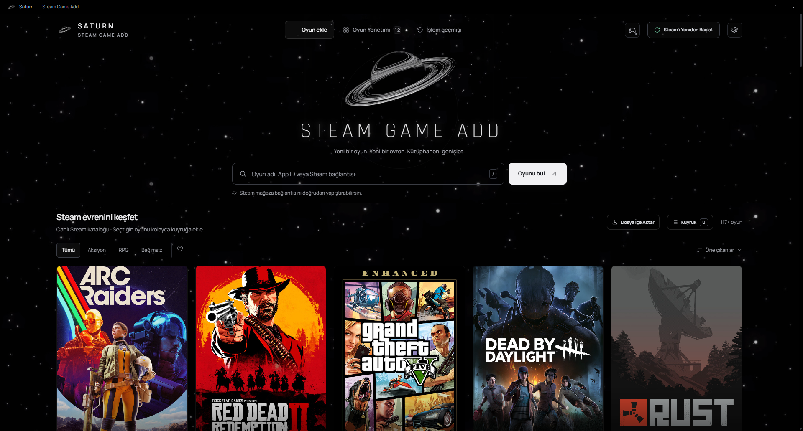
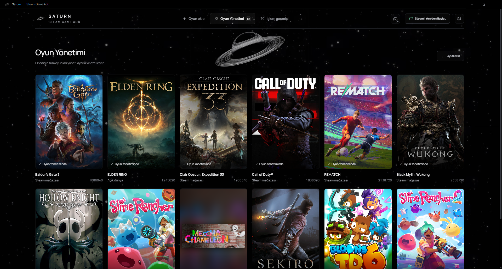

# Saturn — Steam Game Add

Windows için Steam oyunlarını arayıp kuyruğa ekleyebileceğin masaüstü uygulaması.

<p align="center">
  
  
</p>

## Windows kurulumu

[Windows kurulum dosyasını indir (v1.5.0)](https://github.com/Apollonny/Saturn-Game-Add/releases/download/v1.5.0/Saturn-Game-Add-1.5.0-Setup.exe).

Kurulum dijital olarak imzalanmamıştır; Windows SmartScreen uyarısı gösterebilir. SHA-256 ve sürüm bilgileri [GitHub release sayfasında](https://github.com/Apollonny/Saturn-Game-Add/releases/tag/v1.5.0) yer alır.

## Özellikler

- Steam oyunlarını ad, App ID veya mağaza bağlantısıyla ara; kategori ve favorilere göre göz at.
- Oyunları ekleme kuyruğuna al, kütüphaneni ve işlem geçmişini uygulamadan yönet.
- PlayStation DualShock 4 ve DualSense ile Xbox kumandalarını kullan. Kumanda tuşları ve sanal klavye için [CONTROLLERS.md](CONTROLLERS.md) dosyasına bak.
- Satürn animasyonu uygulamanın arka planında görünür.

Canlı Steam araması ve oyun görselleri internet bağlantısı kullanır. Bağlantı yoksa uygulama yerel katalogla açılır.

## Başlatma

Node.js kuruluysa proje klasöründe şu komutları çalıştır:

```powershell
npm ci
npm start
```

Windows kurulum dosyasını `npm run dist:setup`, taşınabilir uygulamayı `npm run dist:win` komutuyla oluştur. Çıktılar `dist` klasörüne yazılır.

Tarayıcı önizlemesi için `npm run preview` çalıştırıp http://127.0.0.1:4173 adresini aç.

## Görseller ve yazı tipleri

Oyun kapakları Steam içerik sunucularından alınır. Satürn videosu uygulama paketindeki animasyon arka planıdır. Manrope ve Rajdhani yazı tipleri SIL Open Font License ile dağıtılır; lisansları `assets` klasöründedir.

## Geliştirici komutları

```powershell
npm run check
npm test
```
